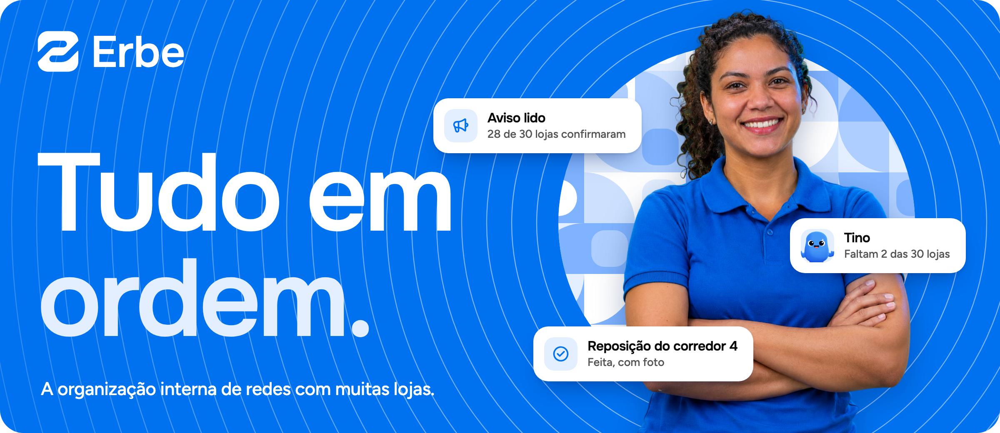
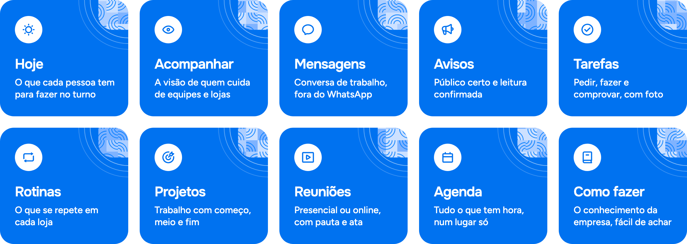

  

  
  
  
  

## O que é

O Erbe é o sistema de organização interna para redes de supermercados, farmácias, restaurantes e negócios parecidos, com dezenas de lojas e centenas ou milhares de funcionários.

Ele não substitui o ERP nem o sistema de RH. O ERP continua sendo a fonte de verdade do negócio. O Erbe é a fonte de verdade de como as pessoas conversam, se organizam, decidem e lembram.

O produto é um app de desktop e um app de celular, e está em construção.

## Os módulos

  

Os módulos são ligados entre si. Um aviso pode pedir uma tarefa, uma reunião gera combinados, uma rotina não cumprida aparece para quem acompanha.

## Este é o Tino

  

O Tino é o agente de IA do Erbe. Pelo desenho do produto, ele responde só com o que a pessoa já tem permissão de ver e mostra tudo antes de fazer: quem confirma é a pessoa.

## Contato

- Conversa sobre o produto: [contato@erbegestao.com.br](mailto:contato@erbegestao.com.br)
- Falha de segurança: [seguranca@erbegestao.com.br](mailto:seguranca@erbegestao.com.br)
- Dados pessoais e privacidade: [privacidade@erbegestao.com.br](mailto:privacidade@erbegestao.com.br)

  

  Feito no Brasil com  pela equipe Erbe.

